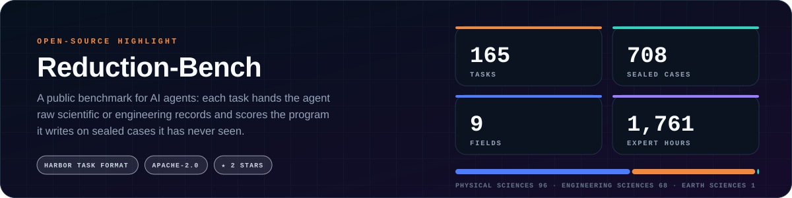
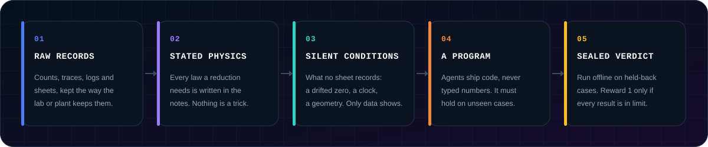
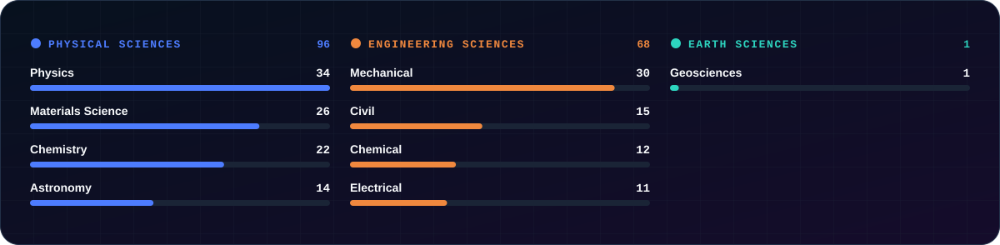
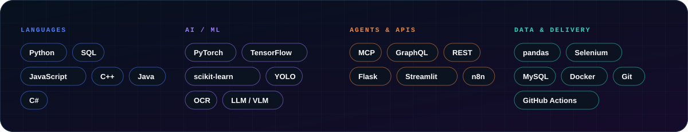

 

 
 

**AI Evaluation Engineer · Scientific & Engineering Benchmarks**

Agentic tasks built from raw measurement records · physical, engineering and earth sciences · verified on sealed cases

## I build tests that AI agents cannot bluff.

**A model that can explain physics is not yet a model that can do the measurement.**

My work sits in the gap between the two. I take the records a laboratory, an observatory, a beamline or a plant really produces (counts, traces, spectra, logger files, run sheets, operator logs, calibration certificates) and turn them into tasks where an AI agent has to write the program a working scientist or engineer would trust with a signature. The program is then run, offline and sealed, on cases nobody has shown it, and only results inside their limits count.

Every number in a task traces back to a physical model of the specimen, the sky or the plant and of each instrument in the chain, so the right answer is known exactly, never voted on.

## Featured: Reduction-Bench

- **What it measures:** whether an agent can reduce raw measurement records to certified results that hold on unseen samples, stations, nights, units and sites.
- **What ships with every task:** instruction, environment, reference solution, a hardened verifier with sealed cases, and the generator plus the author's checks.
- **Where to start:** the [task catalogue](https://github.com/mosalehsoft215-dotcom/reduction-bench/blob/main/tasks/README.md) lists every task with a one-line brief; the [README](https://github.com/mosalehsoft215-dotcom/reduction-bench#running-the-benchmark) shows how to run any task with Harbor.

## How every task is built

## Where the tasks come from

<b>A few of the measurements behind the tasks</b>

 

| Practice | Raw records the agent receives | What its program must certify |
|---|---|---|
| Metrology | free-fall fringe time tags, tides, laser beat, gradient survey | absolute gravity to a couple of microgal |
| Atomic clocks | fountain-minus-maser blocks, Zeeman map over launch heights | maser offset, ageing, collisional and Zeeman shifts |
| Astronomy | six-telescope squared visibilities and closure phases | giant's diameter, companion separation and position angle |
| Power systems | earth-fault disturbance record, relay test via core-balance CT | network capacitive current and coil detuning |
| Process plants | 8 h DCS historian, analyser calibration log, gas certificates | sulfur conversion and SO2 per tonne of acid |
| Structures | stressing records, jack calibrations, 3-D tendon profiles | curvature and wobble friction of post-tensioned tendons |

## Toolbox

## Operating principles

- **Evidence over assertion.** A task is finished when its reference solution, an independent second reduction and the sealed verifier agree, and every shortcut route has been measured and shown to fail.
- **Hidden sizes, never hidden laws.** The notes state every law a reduction needs. What stays sealed is only the size of each condition in the cases the agent never sees.
- **Programs, not answers.** Agents are scored on code that has to generalise, run as an unprivileged user with no network and a time limit.
- **Exact truth.** Synthetic data from physical models of every instrument means the true value is known, so a result is right or wrong, not plausible.
- **Real practice first.** Every task starts from a routine a working lab or plant performs, written in that field's own units, records and standards.

 

The banner, cards and counts on this page are drawn by <a href="./scripts/refresh.py"><code>scripts/refresh.py</code></a> from the live repository and redrawn by GitHub Actions whenever the counts change.

