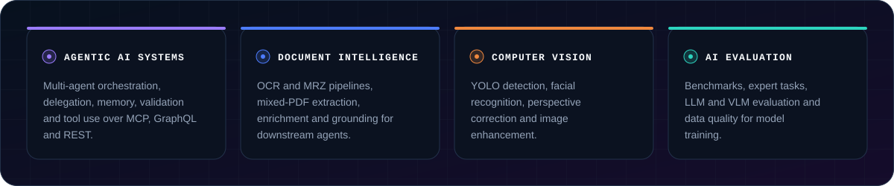
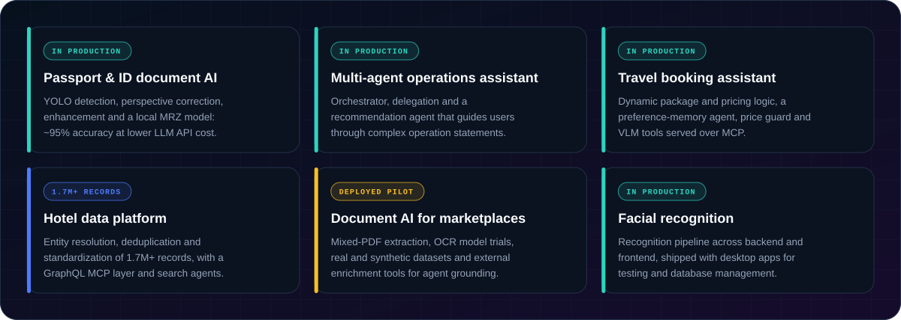
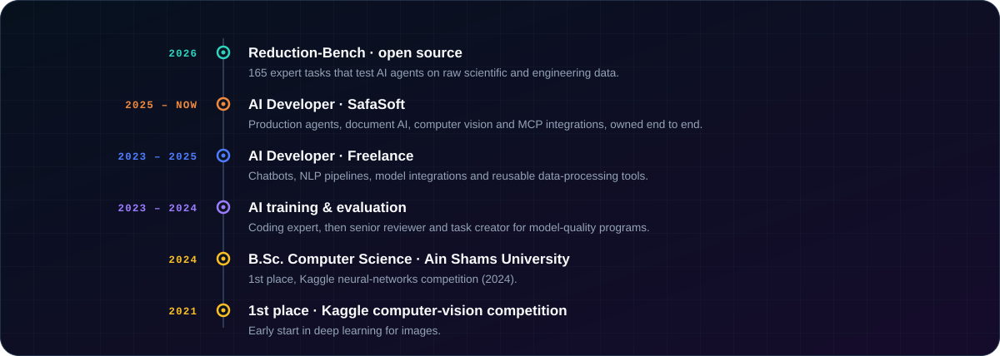

 

 
 

**Mohamed Saleh · AI Engineer**

Agentic AI · Document Intelligence · Computer Vision · AI Evaluation · 3+ years shipping production AI

## I build AI systems that hold up in production.

**From the first messy dataset to the deployed service, and the evaluation that proves it works.**

I am Mohamed Saleh, an AI engineer based in Egypt. Over the past three years I have shipped multi-agent assistants, document-intelligence pipelines and computer-vision applications that run in production for real users, and I have designed expert evaluation tasks and open benchmarks for frontier AI models.

I own delivery end to end: data analysis and preprocessing, model research and training, agent design, APIs and MCP integrations, testing, deployment, and the improvement cycles that follow production feedback. The systems I build are judged by what they do on data nobody cleaned for them.

## Impact at a glance

## What I build

## Selected work

Client and product names are left out on purpose; architecture and results can be walked through on request.

<b>How these systems were built</b>

 

| System | Engineering highlights |
|---|---|
| Passport & ID document AI | Preprocessing chain (perspective correction, upscaling, enhancement, rotation handling), YOLO document detection trained in-house, a local MRZ model that lifted accuracy to about 95% while cutting LLM API usage; shipped as an API service, a test front end and a Windows build. |
| Multi-agent operations assistant | Core agent infrastructure: orchestration, delegation between specialist agents, statement handling and a recommendation agent that guides users step by step. |
| Travel booking assistant | Package and pricing logic, a dynamic package builder, booking guidance, a user-profile and preference-memory agent, VLM tools evaluated through MCP, and contributions to the orchestrator, price guard and analytics. |
| Hotel data platform | ML/NLP entity alignment, duplicate detection and standardization over 1.7M+ hotel records; hotel endpoints and a GraphQL MCP layer feeding search, triage, booking and quotation agents. |
| Document AI for marketplaces | Mixed-PDF extraction, OCR model benchmarking, real and synthetic PDF datasets, external enrichment tools and an extraction tool that grounds downstream agents. |
| Facial recognition | Backend and frontend recognition pipeline in a production app, plus macOS and Windows tools for testing and database management. |

## Open-source highlight

## Experience

## Toolbox

## Recognition & education

- **1st place**, Neural Networks Competition, Kaggle (2024)
- **1st place**, Computer Vision Competition, Kaggle (2021)
- **B.Sc. Computer Science**, Faculty of Computer & Information Science, Ain Shams University (2024)
- Certificates in Data Science and Computer Networks; training in Android (Java) and front-end development

## How I work

- **Production first.** A model is done when it runs reliably for real users, with endpoints, test tools and a deployment path, not when a notebook looks good.
- **Measure before you ship.** Every system gets an evaluation set and a target; I build the benchmark when none exists.
- **Own the whole path.** Data, models, agents, integrations and deployment are one problem, so I treat them as one.
- **Cost-aware by design.** Local models and smart preprocessing where they beat paid APIs, as in the OCR pipeline that raised accuracy while cutting LLM spend.
- **Leave it better documented.** Repositories, endpoints and agent workflows are written up so the next engineer can move fast.

 

**Open to conversations about AI engineering roles and ambitious AI products.**

<a href="https://www.linkedin.com/in/mohamed-saleh-013726274"><b>Connect on LinkedIn</b></a>

 
 

The banner and cards on this page are drawn by <a href="./scripts/refresh.py"><code>scripts/refresh.py</code></a>; open-source counts are read from the live repository and redrawn by GitHub Actions whenever they change.

